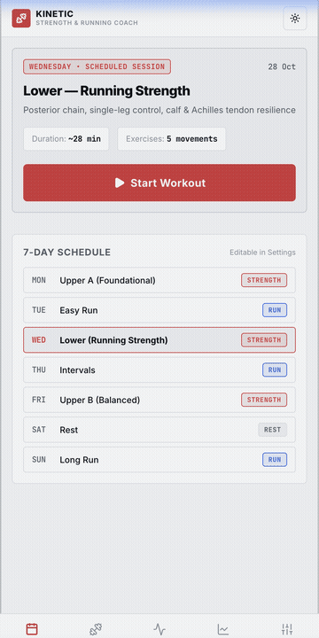
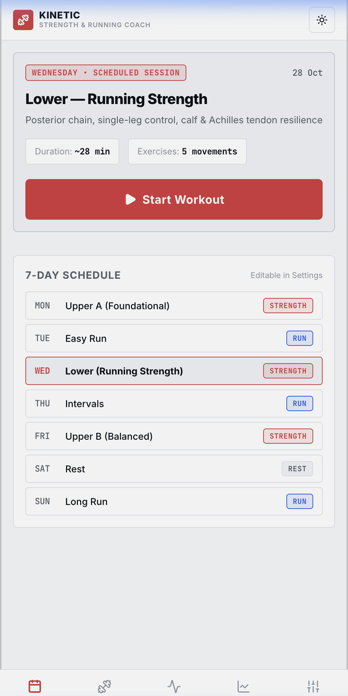
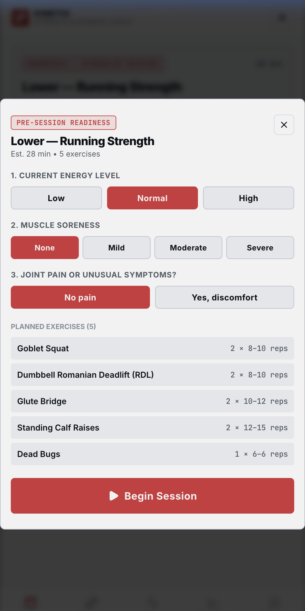
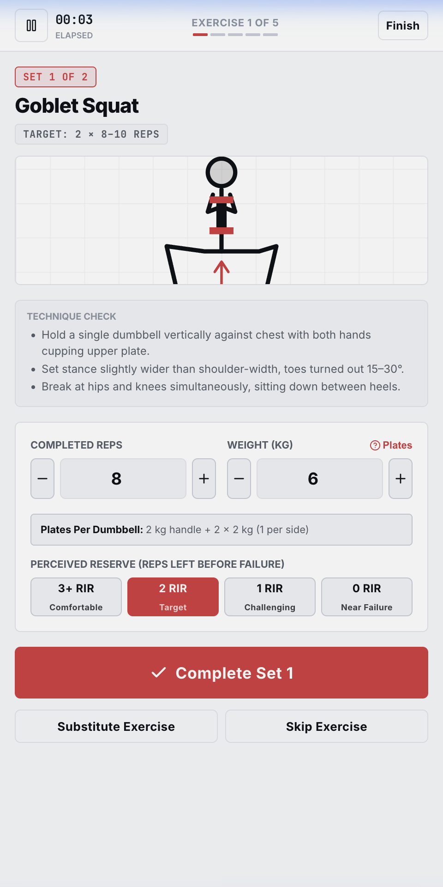
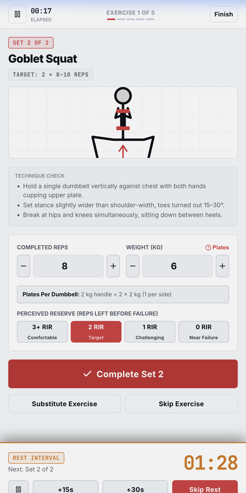
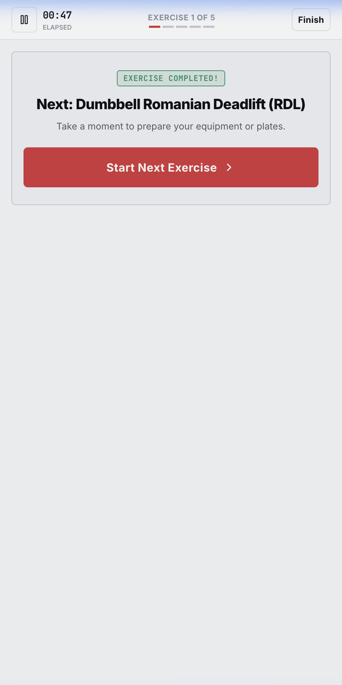
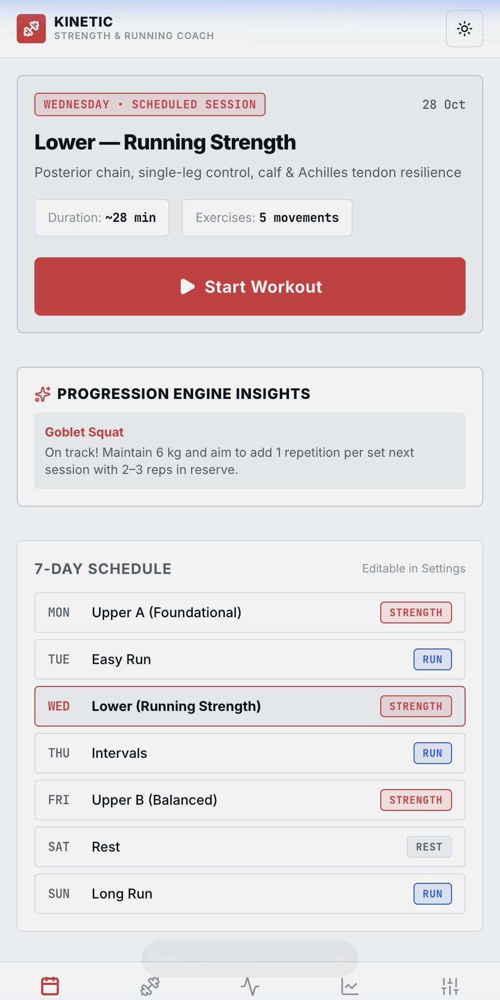

# Kinetic — Personal Strength & Running Coach

> A mobile-first fitness application designed as a personal strength-training and running companion. Built with a minimalist, mathematically structured aesthetic inspired by Swiss modernist design and Max Bill.

[](#-native-android-apk)
[](#%EF%B8%8F-tech-stack)
[](#-design-principles)

---

## 🎬 App Walkthrough

<p align="center">
  
</p>

---

## 📱 Interface Gallery

| 1. Today & Schedule | 2. Pre-Session Readiness | 3. Active Workout Mode |
|:---:|:---:|:---:|
|  |  |  |
| *Today's scheduled session & conflict warnings* | *Screening energy, soreness & joint pain* | *Vector form illustrations & plate calculator* |

| 4. Drift-Proof Rest Timer | 5. Exercise Transition | 6. Strength Plans & Editor |
|:---:|:---:|:---:|
|  |  |  |
| *Absolute timestamp timer with +15s/+30s* | *Up-next preview & equipment prep* | *Upper A, Lower & Upper B editable plans* |

---

## 📦 Native Android APK

The pre-compiled native Android APK is ready in this repository:
- **`kinetic-strength-running-coach.apk`** (4.1 MB)
- Generated via Android SDK & Gradle: `android/app/build/outputs/apk/debug/app-debug.apk`

### Quick Install on Android:
```bash
adb install -r ./kinetic-strength-running-coach.apk
```
*Or copy the `.apk` file directly to your phone and tap it in your file manager to install.*

---

## 🚀 Key Features & Architectural Pillars

### 1. Central Workout Experience
- **Vector SVG Movement Line Diagrams**: Form vectors, joint angles (e.g. elbows 45° to torso, neutral hip hinge), and targeted muscle highlights. Completely resolution-independent and offline.
- **Dumbbell Plate Breakdown Calculator**: Automatically calculates the exact symmetrical plate setup per handle based on your available inventory (e.g. *2 kg handle + 2 × 2 kg plates = 6 kg*).
- **Drift-Proof Rest Timer**: Uses absolute timestamps (`Date.now() + sec * 1000`) so screen locking or app switching never drifts the timer. Includes +15s/+30s extensions and Web Audio synthesized chimes.
- **In-Workout Adaptation**: Single-tap exercise substitutions with safe alternatives, optional movement skipping without failing the workout, and set logging with Reps in Reserve (RIR).
- **Full Crash/Refresh Recovery**: Active workouts auto-save locally on every logged set and resume seamlessly.

### 2. Conservative Double-Progression Engine
- **Non-Failure Principle**: Focuses on 2–3 reps in reserve (RIR). Never encourages failure training.
- **Double Progression**: Adds repetitions across sessions before recommending load increases.
- **Plate Awareness**: Ensures weight suggestions match actual symmetrical plate increments in the user's inventory.
- **Fatigue Protection**: Automatically detects consecutive missed rep targets or excessive soreness and offers volume reduction or deload sessions.

### 3. Running Section & Guided Run Timer
- **Structured Sessions**: **Zone 2 Easy Runs**, **Recovery Runs**, **Long Aerobic Runs**, **Intervals (5 × 2 min)**, **Tempo Runs**, and **Strides**.
- **Phased Guided Timer**: Dynamic Warm-up $\to$ Main Run / Intervals $\to$ Cool-down Routine.
- **Manual Post-Run Logger**: Records distance, duration, pace (min/km), heart rate (bpm), perceived exertion (RPE 1–10), and tendon sensations.

### 4. Optional Plyometrics Module
- **Tendon Pain Gate Screening**: Blocks impact jumping drills if any foot, ankle, Achilles, or knee ache is reported, recommending gentle mobility alternatives.
- **3 Progressive Stages**: Stage 1 (Preparation), Stage 2 (Introductory Impact), and Stage 3 (Progression), tracking ground contacts.

### 5. Weekly Schedule & Smart Guardrails
- **Default Schedule**: Upper A, Easy Run, Lower-Body Strength, Intervals, Upper B, Rest, Long Run.
- **48-Hour Recovery Guardrail**: Warns if heavy leg training is scheduled within 48 hours before the long endurance run.

### 6. Local Persistence & Data Ownership
- 100% offline capable.
- Full JSON export and import with schema validation.

---

## 🛠️ Tech Stack

- **Frontend**: React 19, TypeScript, Vite
- **Mobile Container**: Capacitor 7 (Native Android build)
- **Styling**: Swiss Modernist Vanilla CSS (8-point spatial grid, tabular typography, dark/light modes)
- **Icons**: Lucide Icons
- **Audio**: Web Audio API (zero external asset dependencies)

---

## 💻 Development & Building

### Install Dependencies:
```bash
npm install
```

### Run Web Development Server:
```bash
npm run dev
```

### Build Web Assets:
```bash
npm run build
```

### Compile Native Android APK:
```bash
npx cap sync android
cd android && ./gradlew assembleDebug
```
Output APK location: `android/app/build/outputs/apk/debug/app-debug.apk`
